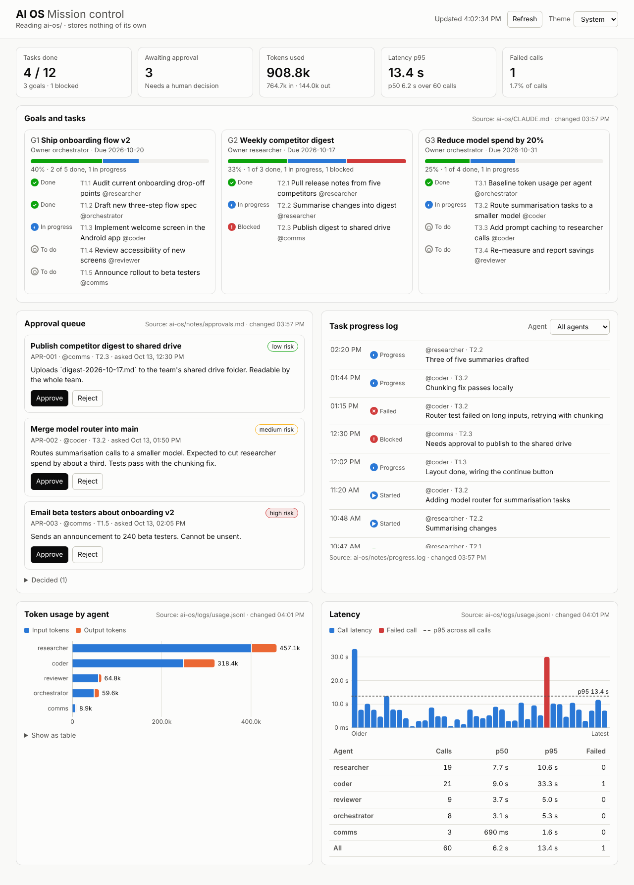
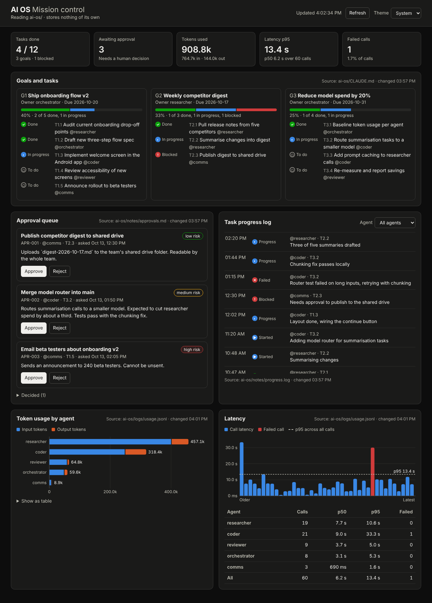

# AI OS dashboard

Mission control for the Claude-orchestrated agent system. The dashboard stores
no data of its own: every request re-reads the files in `ai-os/`, so if it
crashes, restarting it shows exactly the same state.

```sh
cd dashboard
npm start          # http://127.0.0.1:4173 (no dependencies to install)
npm test           # parser tests
```

Environment: `PORT` (default 4173), `HOST` (default 127.0.0.1), `AI_OS_DIR`
(default `../ai-os`).

## Panels and where they read from

| Panel | File | Format |
|-------|------|--------|
| Goals and tasks | `ai-os/CLAUDE.md` | `### G1 · Title` headings under `## Goals`, then `- [ ] T1.1 Task (@agent)`. Markers: `[ ]` todo, `[~]` in progress, `[x]` done, `[!]` blocked |
| Task progress log | `ai-os/notes/progress.log` | `timestamp \| agent \| task \| status \| message`, one per line |
| Token usage, Latency | `ai-os/logs/usage.jsonl` | One JSON object per model call: `ts, agent, task, model, input_tokens, output_tokens, latency_ms, ok` |
| Approval queue | `ai-os/notes/approvals.md` | `## APR-001 · Title` sections with `- status: pending` and other `- key: value` lines |

The only write the dashboard makes is the Approve / Reject button, which
rewrites that item's `status:` line in `approvals.md` and adds `decided:`.
Agents pick up the decision by reading the same file.

A missing or malformed file only blanks its own panel, with the reason shown.
The page polls every 5 seconds and re-renders only when a file changed.

## Screenshots



